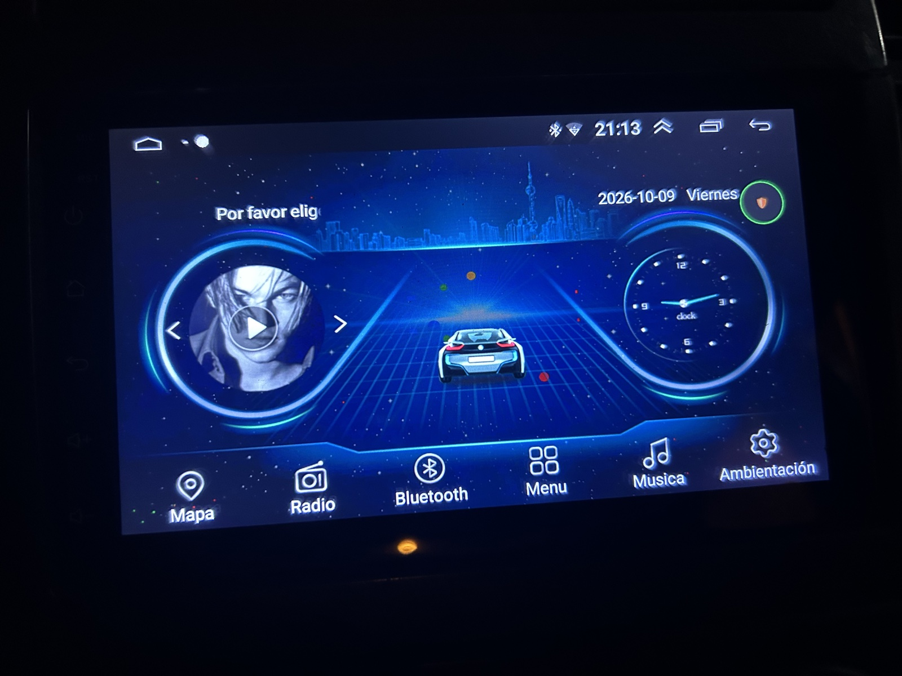
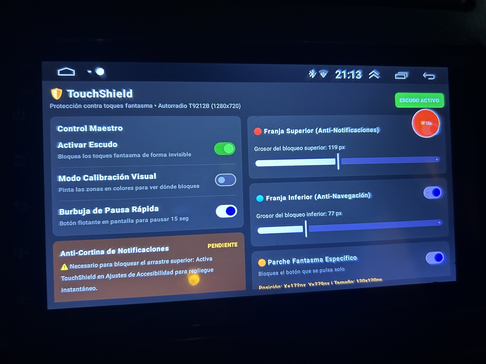
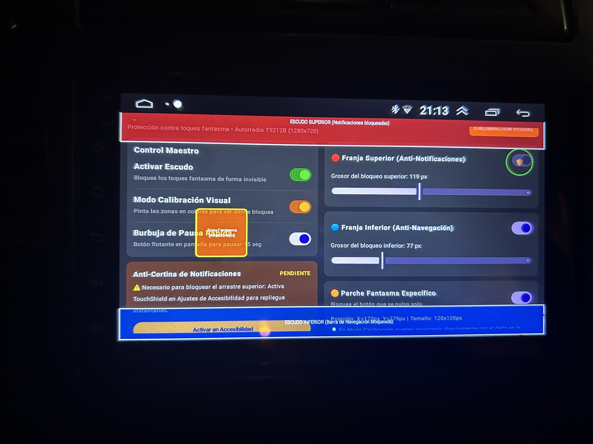
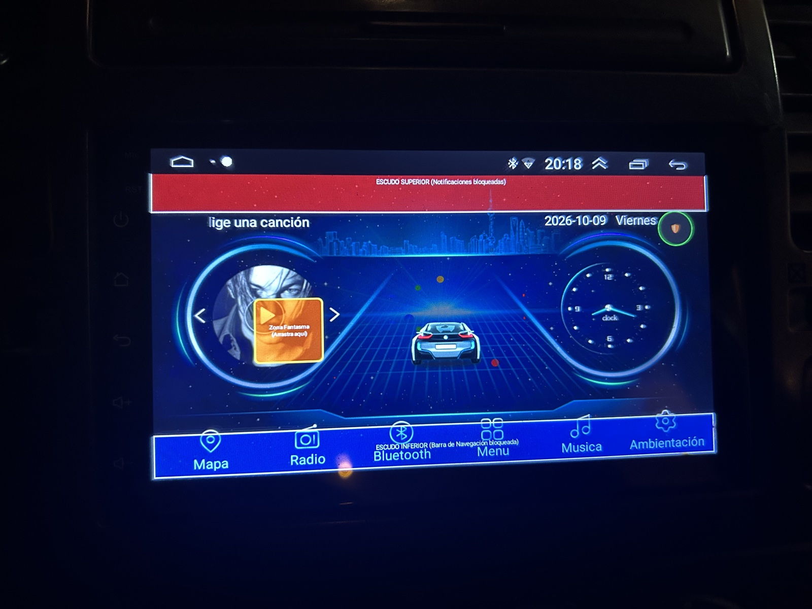
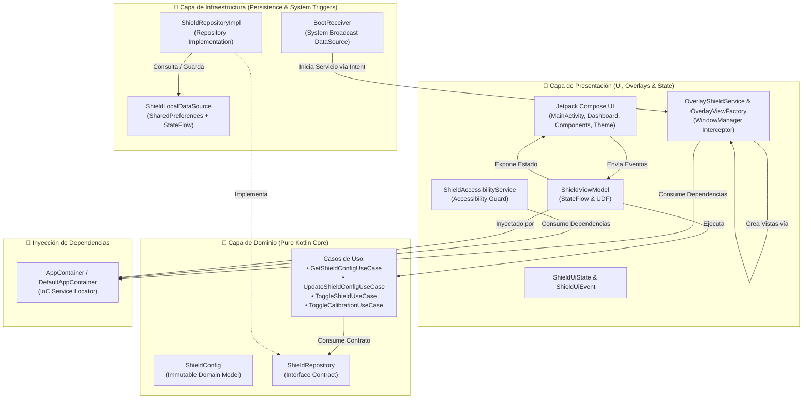

# 🛡️ TouchShield: Automotive Ghost-Touch Interceptor & Edge Guard

[](https://kotlinlang.org)
[](https://developer.android.com/jetpack/compose)
[](https://developer.android.com/topic/architecture)
[-success.svg?logo=android)](https://developer.android.com)
[]()
[](LICENSE)

**TouchShield** es una solución de software de grado automotriz diseñada para mitigar y neutralizar fallas físicas de **"toques fantasma" (ghost touches)** en pantallas táctiles y autorradios con sistema operativo Android (como procesadores T9212B, AC8227L, Allwinner, Rockchip, etc.), sin necesidad de rootear el dispositivo ni utilizar comandos ADB desde un computador.

Construido siguiendo los estándares más rigurosos de **Clean Architecture**, **Principios SOLID**, **Patrones de Diseño**, **Jetpack Compose** y **Kotlin Coroutines / StateFlow**.

---

## 📸 Fotos reales en el vehículo

Fotografías de TouchShield instalado en el autorradio. Las zonas de colores corresponden al modo de calibración y permiten ver dónde se bloquean los toques.

| Pantalla principal del autorradio | Panel de control de TouchShield |
|:---:|:---:|
|  |  |
| **Calibración desde el panel** | **Zonas de bloqueo sobre el autorradio** |
|  |  |

---

## 🎯 El problema real y la solución que apliqué

### El problema en mi autorradio

TouchShield nació para abordar los **toques fantasma en la pantalla del autorradio de mi vehículo**: pulsaciones involuntarias que interferían con el uso normal de la interfaz. Necesitaba proteger los bordes y poder bloquear una zona concreta sin perder el uso del resto de la pantalla.

En las fotos se ve la aplicación instalada en el vehículo. El panel identifica el equipo como **T9212B (1280 × 720)**. El parche de bloqueo está colocado sobre el botón de reproducción del inicio, y las franjas cubren las zonas superior e inferior.

### La solución que apliqué

Desarrollé **TouchShield** para mitigar el problema mediante zonas táctiles bloqueadas y ajustables:

1. **Franja superior** para interceptar toques en la zona de notificaciones.
2. **Franja inferior** para bloquear pulsaciones involuntarias en los controles de la parte baja.
3. **Parche específico** para cubrir el punto problemático; en la foto está sobre el botón de reproducción.
4. **Calibración visual** para colocar el parche y ajustar las franjas viendo exactamente qué superficie queda bloqueada. Después se pueden ocultar los colores para el uso habitual.
5. **Burbuja flotante** para pausar la protección durante 15 segundos cuando necesito tocar una zona bloqueada.

En el panel fotografiado, la franja superior está ajustada a **119 px**, la inferior a **77 px** y el parche a **120 × 120 px**, con posición **X = 172 px, Y = 279 px**. Son los ajustes mostrados en este equipo; cada pantalla requiere su propia calibración.

La aplicación mitiga las pulsaciones en las zonas cubiertas; no repara el digitalizador. Las fotos documentan la instalación y la configuración, pero no permiten determinar la causa física ni medir la eliminación de los toques fantasma. Además, el permiso de **accesibilidad aparece como pendiente**: debe habilitarse para que funcione el cierre automático de la cortina de notificaciones.

### La Solución TouchShield
1. **Escudo de Toques Físicos (`WindowManager` Overlays)**: Inyecta franjas invisibles (`TYPE_APPLICATION_OVERLAY`) calibrables al milímetro que absorben y descartan eventos de contacto capacitivo en los bordes antes de que alcancen el sistema o las aplicaciones activas.
2. **Guardián de Accesibilidad (`AccessibilityService`)**: Monitorea eventos de ventana del sistema (`TYPE_WINDOW_STATE_CHANGED`). Si una ráfaga fantasma logra deslizar la barra de notificaciones (`com.android.systemui`), el servicio solicita el cierre de la cortina con `GLOBAL_ACTION_DISMISS_NOTIFICATION_SHADE` en Android 12 o posterior, y con `GLOBAL_ACTION_BACK` en versiones anteriores. Requiere habilitar el permiso de accesibilidad.
3. **Arranque Autónomo (`BootReceiver`)**: Inicia los servicios de protección automáticamente tras encender el vehículo (`BOOT_COMPLETED`), garantizando protección desatendida.
4. **Calibración Visual**: Permite teñir las zonas bloqueadas de colores translúcidos para ajustar con precisión de píxeles el área dañada sin afectar la visibilidad de los controles de la radio.

---

## 🏛️ Arquitectura del Software (Clean Architecture)

El proyecto sigue una separación estricta en capas desacopladas, asegurando alta cohesión, bajo acoplamiento, testabilidad y facilidad de mantenimiento.



### 1. Capa de Dominio (`domain`)
- **Independiente de Android**: Código Kotlin puro. No importa bibliotecas de vistas ni de persistencia.
- **Modelos de Dominio (`domain/model`)**: `ShieldConfig`, clase de datos inmutable que representa el estado del escudo y las dimensiones de cada zona.
- **Contratos de Repositorio (`domain/repository`)**: `ShieldRepository`, interfaz que define el flujo reactivo `Flow<ShieldConfig>` y los métodos de actualización.
- **Casos de Uso (`domain/usecase`)**: Encapsulan la lógica de negocio individual y reutilizable:
  - `GetShieldConfigUseCase`: Obtiene el stream reactivo de configuración.
  - `UpdateShieldConfigUseCase`: Persiste actualizaciones de configuración.
  - `ToggleShieldUseCase`: Activa o suspende el escudo maestro.
  - `ToggleCalibrationUseCase`: Alterna el modo de visualización de zonas.

### 2. Capa de Infraestructura (`infrastructure`)
- **Implementación de Repositorio (`infrastructure/repository`)**: `ShieldRepositoryImpl` implementa el contrato de dominio `ShieldRepository`.
- **Fuente de Datos Local (`infrastructure/datasource`)**: `ShieldLocalDataSource` abstrae `SharedPreferences` con soporte reactivo mediante `MutableStateFlow` y ejecución en `Dispatchers.IO`.
- **Triggers del Sistema (`infrastructure/receiver`)**: `BootReceiver` actúa como una fuente de eventos del sistema operativo (`BOOT_COMPLETED`), garantizando el inicio desatendido al encender el vehículo sin violar la arquitectura.

### 3. Capa de Presentación (`presentation`)
- **Patrón MVVM + Unidirectional Data Flow (UDF)**:
  - `ShieldUiState`: Clase inmutable que describe la pantalla completa (estado del escudo, permisos, configuración, estados temporales).
  - `ShieldUiEvent`: `sealed interface` para todos los eventos generados por el usuario.
  - `ShieldViewModel`: Administra la lógica de presentación y expone un único `StateFlow<ShieldUiState>`.
- **Interfaz Visual (`presentation/ui`)**:
  - `MainActivity`: Punto de entrada gráfico (Activity) que hospeda el árbol de Compose.
  - `components/`: Componentes modulares (`ShieldHeader`, `PermissionsCard`, `MasterControlsCard`, `ZoneControlsCard`).
  - `theme/`: Colores, tipografía y estilos visuales de Jetpack Compose.
- **Superposiciones del Sistema (`presentation/overlay`)**:
  - `OverlayShieldService`: Foreground Service que gestiona las ventanas flotantes en el `WindowManager`.
  - `ShieldAccessibilityService`: Servicio de accesibilidad para la neutralización instantánea de cortinas de notificación fantasma.
  - `OverlayViewFactory`: Factoría encargada de instanciar y configurar las vistas de superposición del `WindowManager`.

---

## ⚡ Tecnologías y Herramientas

- **Lenguaje**: Kotlin 2.0.21
- **Interfaz de Usuario**: Jetpack Compose & Material 3 (BOM 2024.09.00)
- **Concurrencia Reactiva**: Kotlin Coroutines & StateFlow (Flow)
- **Ciclo de Vida**: Jetpack Lifecycle ViewModel Compose (`lifecycle-viewmodel-compose`)
- **Servicios de Sistema Android**:
  - `android.view.WindowManager` (Layout Overlays)
  - `android.accessibilityservice.AccessibilityService` (Anti-notification pull guard)
  - `android.app.NotificationManager` & Foreground Service Notification Channels
  - `android.content.BroadcastReceiver` (Auto-boot trigger)
- **Target SDK**: Android 14 / Android 12 (API 32-35) con compatibilidad hacia atrás hasta Android 8.0 (API 26).

---

## 🚀 Compilación e Instalación

### Compilación desde código fuente:
```bash
# Clonar el repositorio
git clone https://github.com/albinrk10/ghost-touch-killer
cd TouchShield

# Compilar APK Debug
./gradlew assembleDebug
```
El archivo APK generado se ubicará en:
`app/build/outputs/apk/debug/app-debug.apk`

### Instalación en Autorradio / Pantalla de Auto:
1. Copia el archivo `TouchShield-v1.0.apk` a una memoria USB.
2. Conecta la memoria USB al puerto USB de tu autorradio.
3. Abre el explorador de archivos de la radio e instala el APK.
4. Concede los dos permisos solicitados:
   - **Permiso de Superposición / Mostrar sobre otras apps** (necesario para el bloqueo táctil).
   - **Permiso de Accesibilidad** (necesario para cerrar la barra si se despliega sola).
5. Ajusta los controles de calibración y activa el escudo protector.

---


